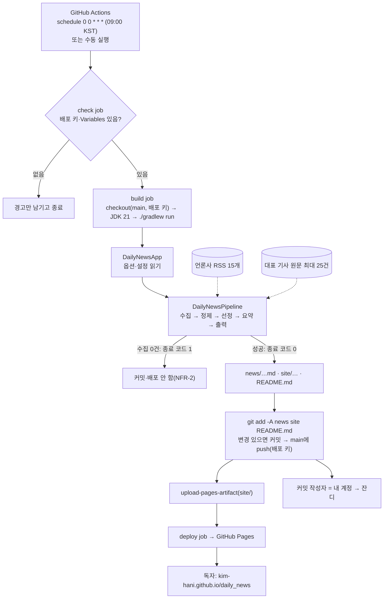
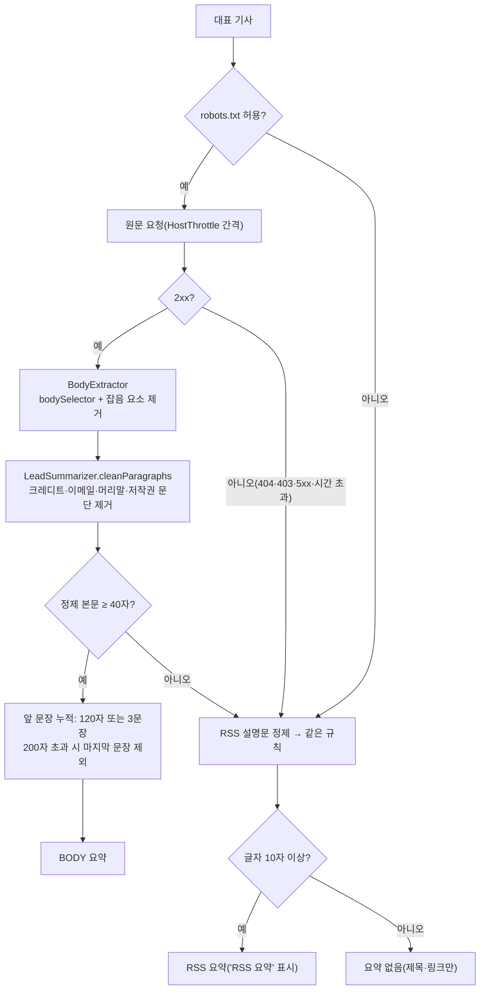
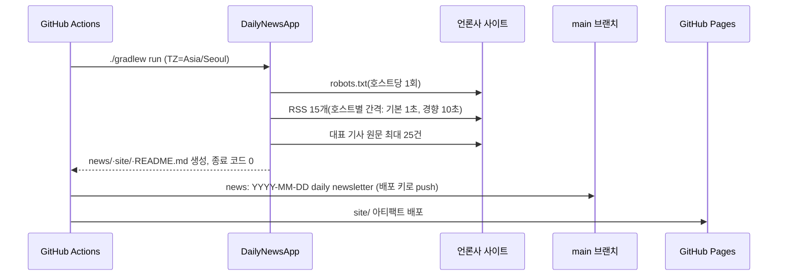

# Daily News — 구현 보고서

> 기준 문서: [spec.md](./spec.md) · [plan.md](./plan.md) · [tasks.md](./tasks.md) · [setup-guide.md](./setup-guide.md)
> 브랜치: `feature/daily-news` · 작성일: 2026-10-28

이 문서는 G1~G12 작업을 **어떻게 수행했고**, **어떤 기능을 구현했으며**, 프로그램이 **어떤 흐름으로 동작하는지** 정리한 문서입니다.
작업별 상세 메모(테스트 개수, plan 대비 변경 이유)는 [tasks.md](./tasks.md)의 Progress 표에도 남아 있습니다.

---

## 1. 한눈에 보기

| 항목 | 내용 |
|---|---|
| 하는 일 | 매일 09:00 KST에 연합뉴스·동아일보·경향신문의 RSS 15개를 모아 정치·사회·경제·IT·글로벌별 주요 사안 5개를 고르고, 원문 앞 문장으로 요약한 뉴스레터를 만든다 |
| 결과물 | `news/YYYY/MM/YYYY-MM-DD.md`(영구 보관), `site/index.html`·`site/archive/YYYY-MM-DD.html`(30일 보관)·`site/archive.html`, `README.md` 최신 구간 |
| 게시 | GitHub Actions가 main에 커밋하고 GitHub Pages로 배포(`daily-news.yml`) |
| 기술 | Java 21, Gradle 9.8.2, Rome(RSS), jsoup(HTML), Thymeleaf(웹), KOMORAN(형태소), Jackson YAML(설정), JUnit 6 + AssertJ |
| AI 사용 | 없음. 선정은 규칙 기반 점수, 요약은 원문 문장 인용(SC5) |
| 규모 | main 59개 파일(약 3,200줄), test 40개 파일, 테스트 **286개 통과** + 라이브 테스트 15개 |
| 작업 상태 | 39개 중 **37개 Done**, 2개 Blocked(T-037·T-038: 사용자 GitHub 설정과 7일 운영 관찰 대기) |
| 실제 실행 | 수집 1,100건 → 정제 999건 → 선정 25건, 2곳 이상 보도 사안 20/25, 파이프라인 114초 |

---

## 2. 전체 흐름도

### 2.1 시스템 전체


### 2.2 파이프라인 단계와 데이터

```mermaid
flowchart LR
    cfg["sources.yml<br/>ConfigLoader"] -->|AppConfig| col
    col["① FeedCollector<br/>robots → 요청 → RssParser"] -->|"List&lt;Article&gt;<br/>+ failedFeeds"| cln
    cln["② ArticleCleaner<br/>URL 정규화·24h·중복 제거"] -->|List&lt;Article&gt;| flt
    flt["③ CategoryFilter<br/>IT 피드 키워드 필터"] -->|List&lt;Article&gt;| clu
    clu["④ StoryClusterer<br/>제목 유사도 single-link"] -->|"카테고리별<br/>ArticleCluster"| sel
    sel["⑤ StorySelector + StoryRanker<br/>점수·대표·Top 5"] -->|"카테고리별 Story"| sum
    sum["⑥ SummaryService<br/>원문 → BodyExtractor → LeadSummarizer"] -->|"카테고리별 NewsItem"| nl
    cln -->|제목| kw["⑦ KeywordExtractor<br/>KOMORAN 명사 Top 10"]
    kw --> nl["Newsletter<br/>+ RunStats"]
    nl --> md["⑧ MarkdownRenderer"]
    nl --> web["⑨ HtmlRenderer"]
    web --> ret["⑩ RetentionCleaner<br/>웹 30일"]
    ret --> arc["⑪ ArchiveRenderer"]
    arc --> rd["⑫ ReadmeUpdater"]
```


| 단계 | 클래스 | 입력 → 출력 | 핵심 규칙 |
|---|---|---|---|
| 설정 | `ConfigLoader` | `sources.yml` → `AppConfig` | 필수 항목·범위·http(s)·정규식·도메인 검증, 오류 위치를 담은 `ConfigException` |
| ① 수집 | `FeedCollector`, `RssParser` | 피드 URL → `List<Article>` | robots 차단·2xx 외·요청 실패·파싱 실패 피드만 건너뜀(`yonhap/POLITICS` 형식 기록) |
| ② 정제 | `ArticleCleaner`, `UrlNormalizer`, `TitleNormalizer` | 기사 → 기사 | utm 제거·도메인 검증, 24시간 창(경계 포함), 같은 카테고리의 URL·제목 중복은 가장 이른 것만 |
| ③ 필터 | `CategoryFilter` | 기사 → 기사 | IT 피드는 IT 키워드가 있어야 통과(영문은 단어 경계) |
| ④ 묶기 | `StoryClusterer`, `TitleSimilarity` | 기사 → `ArticleCluster` | `max(2-gram Jaccard, 명사 Jaccard) ≥ 0.4`면 같은 사안, 여러 클러스터와 이어지면 병합 |
| ⑤ 선정 | `StoryRanker`, `StorySelector` | 클러스터 → `Story` | 점수 = 언론사 수×10 + 최신성, 정치→사회→경제→글로벌→IT 순으로 Top 5, 앞에서 쓴 URL 제외 |
| ⑥ 요약 | `SummaryService`, `BodyExtractor`, `SentenceSplitter`, `LeadSummarizer` | `Story` → `NewsItem` | 원문 앞 2~3문장(≤200자), 실패하면 RSS, 없으면 NONE |
| ⑦ 키워드 | `KeywordExtractor`, `KomoranAnalyzer` | 제목 → 10개 | 명사가 나온 제목 수, 불용어 제외, 동률이면 고유명사 → 가나다 |
| ⑧~⑫ 출력 | `MarkdownRenderer`, `HtmlRenderer`, `RetentionCleaner`, `ArchiveRenderer`, `ReadmeUpdater` | `Newsletter` → 파일 | 날짜로만 경로 결정(멱등), 웹 30일·Markdown 영구, README 마커 구간만 교체 |

### 2.3 요약 결정 흐름(⑥)


### 2.4 일일 실행 시퀀스


---

## 3. 코드 구조

```
src/main/java/dailynews/
├─ DailyNewsApp          진입점: 옵션·설정 → 파이프라인 → 종료 코드(0/1/2)
├─ CliOptions            --date, --root, --config, --dry-run
├─ DailyNewsPipeline     단계 조립. AppConfig·HttpFetcher·Clock을 주입받아 테스트 가능
├─ config/   AppConfig, SourceConfig(YAML 원본), ConfigLoader, ConfigException
├─ model/    Category, Source, Article, Story, Summary(+Origin), NewsItem, Newsletter, RunStats (불변 record)
├─ http/     HttpFetcher, FetchResult, JdkHttpFetcher, HostThrottle, RobotsPolicy, RobotsRules, Sleeper
├─ collect/  RssParser, RssParseException, FeedCollector, CollectResult
├─ clean/    UrlNormalizer, TitleNormalizer, ArticleCleaner, CategoryFilter
├─ select/   TitleSimilarity, ArticleCluster, StoryClusterer, StoryRanker, StorySelector
├─ summary/  BodyExtractor, SentenceSplitter, LeadSummarizer, SummaryService
├─ keyword/  KomoranAnalyzer, KeywordExtractor
└─ render/   OutputPaths, Formats, Templates, MarkdownRenderer, HtmlRenderer,
             RetentionCleaner, ArchiveRenderer, ReadmeUpdater
src/main/resources/
├─ sources.yml                         설정(언론사·피드·selector·간격·키워드·보관 기간)
├─ templates/ layout.html, newsletter.html, archive.html
└─ static/    style.css, tabs.js
src/test/java/dailynews/…              단위·통합 테스트 34개 클래스 + LiveFeedSmokeTest
src/test/resources/fixtures/           실제 RSS·기사 HTML·robots.txt(2026-10-28 수집, README에 출처)
src/test/resources/golden/             Markdown golden file
.github/workflows/ ci.yml(PR 테스트), daily-news.yml(일일 실행·배포)
```

**설계 원칙**
- **단계 분리(NFR-7)**: 단계마다 입력과 출력이 분명한 클래스. 단계 사이 데이터는 모두 불변 record다.
- **네트워크 추상화**: 모든 HTTP는 `HttpFetcher` 뒤에 있다. 실제 실행은 `HostThrottle(JdkHttpFetcher)`, 테스트는 `FakeHttpFetcher`(fixture 응답)다.
- **시간 주입**: `Clock`을 주입해서 24시간 필터·최신성·출력 날짜를 테스트에서 고정한다.
- **부분 실패 허용(NFR-2)**: 피드·본문 단위 오류는 기록하고 계속 진행한다. 수집 0건일 때만 종료 코드 1이다.
- **멱등(FR-7.4)**: 경로는 날짜로만 정한다. 같은 입력이면 두 번 실행해도 모든 파일이 바이트 단위로 같다(통합 테스트로 확인).

---

## 4. 작업 그룹별 수행 내역

진행 방식: 그룹마다 작업 단위로 커밋하고, PR → `ci / test` 통과 → main 병합 → 작업 브랜치 rebase 순서로 반영했다.
G1~G4는 PR #1~#4로 병합했고, G5~G12는 이 문서와 함께 하나의 PR로 올린다.

### G1. 프로젝트 기반 (T-001~T-003) — PR #1
| 작업 | 수행 방법 | 구현 결과 |
|---|---|---|
| T-001 Gradle 초기화 | 시스템 Gradle 8.13으로 Wrapper를 만들고, 9.8.2로 다시 생성해 jar·스크립트 버전을 맞춤 | JDK 21 toolchain, plan §11 의존성, `live` 태그 제외, `liveTest` 태스크, `.gitignore`·`.gitattributes` |
| T-002 패키지 골격 | 9개 패키지마다 역할을 적은 `package-info.java`(빈 폴더도 git에 남도록) | `DailyNewsApp` 시작 로그, 빌드 확인 테스트 |
| T-003 PR CI | `ci.yml`: checkout → JDK 21 → wrapper 검증 → setup-gradle → `./gradlew test` | PR #1에서 `ci / test` 통과(36초) |

- **plan 대비 변경**:
  - Gradle 9 문법(`url = …`)을 썼다.
  - `slf4j-api`를 의존성에 추가했다.
  - `liveTest`에 classpath를 지정했다(Gradle 9 필수).
- **발견**: Windows에서는 `gradlew`의 실행 권한이 빠지므로 `git add --chmod=+x`로 넣어야 했다.

### G2. 모델·설정 (T-004~T-005) — PR #2
| 작업 | 수행 방법 | 구현 결과 |
|---|---|---|
| T-004 도메인 모델 | record 생성자에서 방어적 복사, 카테고리 키는 EnumMap/EnumSet으로 순서 고정 | `Category`(라벨·이모지·slug) + record 8종 |
| T-005 설정 | YAML을 `SourceConfig` 원본으로 읽고 검증한 뒤 `Source`로 변환. 오류 메시지에 `파일: sources[yonhap].feeds.IT: …`처럼 위치를 넣음 | `sources.yml`, `ConfigLoader`(classpath·`--config`) |

- **발견**: plan·tasks에 "피드 14개"로 적혀 있었지만 실제는 3사 × 5카테고리 = 15개라 문서를 고쳤다.

### G3. HTTP 계층 (T-006~T-008) — PR #3
| 작업 | 수행 방법 | 구현 결과 |
|---|---|---|
| T-006 HttpFetcher | JDK `HttpClient`, 테스트는 JDK 내장 `HttpServer`로 재시도·리다이렉트·UA를 검증 | `JdkHttpFetcher`(5xx·시간 초과 1회 재시도, 1초 대기), `FakeHttpFetcher` |
| T-007 HostThrottle | 데코레이터. 가짜 `Clock`·`Sleeper`로 대기 시간을 검증 | 같은 호스트에 연속 요청할 때 간격을 둠(직전 요청이 끝난 시각 기준) |
| T-008 RobotsPolicy | 실제 robots.txt 5개를 fixture로 저장하고 RFC 9309 규칙으로 해석 | 최장 일치, 동률이면 Allow, `*`·`$`, 다중 UA 그룹, 호스트별 캐시, 4xx는 허용·5xx는 차단 |

- **plan 대비 변경**: robots.txt 응답이 404뿐 아니라 4xx 전체이면 "모두 허용"으로 처리했다(RFC 기준).
- **확인한 실제 사례**:
  - 서울신문은 `/xml/`(RSS)이 차단된다.
  - 연합 영문 기사(`/view/AEN…`)는 차단된다.
  - 동아는 대문자 `/NEWS`만 막는다(경로 대소문자 구분).

### G4. RSS 수집 (T-009~T-011) — PR #4
| 작업 | 수행 방법 | 구현 결과 |
|---|---|---|
| T-009 fixture | 정치 RSS(앞 15개 item)와 기사 HTML 6개를 받아, 저작권·용량을 고려해 본문 컨테이너의 앞 4문단과 잡음 요소만 남김 | `fixtures/{yonhap,donga,khan}/`, 출처를 적은 `README.md`, 공통 헬퍼 `Fixtures` |
| T-010 RssParser | Rome + `XmlReader`(인코딩 자동 판단), description은 jsoup으로 텍스트만 남김 | `pubDate`·`dc:date`를 KST로, 날짜·제목·링크가 없거나 잘못된 item은 건너뜀 |
| T-011 FeedCollector | 언론사 × 카테고리 순서로 수집, 실패 사유를 내부 예외로 모아 로그로 남김 | `CollectResult(articles, failedFeeds)` |

- **발견한 사이트 특성**:
  - 경향 기사 페이지는 연속으로 요청하면 403을 돌려준다(빈도 제한).
  - 동아 본문은 `<p>` 없이 텍스트와 `<br>`로 되어 있다.
  - 경향 본문의 첫 문단은 소제목(`b.strapline`)이다.

### G5. 정제·중복 제거 (T-012~T-015)
| 작업 | 수행 방법 | 구현 결과 |
|---|---|---|
| T-012 UrlNormalizer | `&amp;` 디코딩 → URI 해석 → 스킴·도메인 검증 → 문자열 재조립 | utm_*·fbclid·gclid·fragment·기본 포트·끝 `/` 제거, 소문자화 |
| T-013 TitleNormalizer | 정규식 단계 처리 | `clean()`(말머리·`(종합2보)`·따옴표 제거, 대소문자 유지)과 `normalize()`(특수문자 제거·소문자) |
| T-014 ArticleCleaner | 가장 이른 순으로 훑으며 두 종류의 중복 키(URL, 언론사+제목)를 기록하고, 결과는 입력 순서를 유지 | 24시간 경계 포함·미래 제외, 같은 카테고리 안의 중복 제거 |
| T-015 CategoryFilter | 모든 키워드를 하나의 정규식으로 합치고 앞뒤에 "영문자·숫자 없음" 경계를 붙임 | `AI`가 `MAIN`에 걸리지 않고, `AI가`·`5G망`은 맞음 |

- **plan 대비 변경**: 피드 호스트(`rss.donga.com`)와 기사 호스트(`www.donga.com`)가 달라서, 언론사 도메인을 `sources.yml`의 `domains`로 명시했다. 피드 호스트도 이 도메인에 속하는지 검증한다.

### G6. 주요 기사 선정 (T-016~T-019)
| 작업 | 수행 방법 | 구현 결과 |
|---|---|---|
| T-016 KomoranAnalyzer | FULL 모델을 지연 초기화 싱글턴으로 한 번만 로딩(약 3.3초) | 2글자 이상 NNP·NNG + 영문(SL) |
| T-017 TitleSimilarity | fixture의 실제 제목 쌍 19개로 유사도를 먼저 측정해 임계값을 정함 | 같은 사안 0.36~0.75, 다른 사안 최대 0.19 → **0.4 유지** |
| T-018 StoryClusterer | 최신순으로 순회, 비교용 특징을 한 번만 계산해 재사용 | 새 기사가 여러 클러스터와 이어지면 **클러스터 병합**(순서에 좌우되지 않음) |
| T-019 Ranker·Selector | 점수 정렬(동점이면 기사 수 → 최근 대표 → URL), 카테고리 간 URL 제외 | Top 5, 후보가 적으면 있는 만큼, 빈 카테고리도 결과에 포함 |

- **plan 대비 변경**:
  - 영문 약어(SCM, AI)도 명사로 포함했다.
  - 순수 greedy 방식은 실제 제목에서 같은 사안이 둘로 갈려서(연합-동아 0.36, 둘 다 경향과는 0.4 이상) 병합 방식으로 바꿨다.

### G7. 본문 요약 (T-020~T-023)
| 작업 | 수행 방법 | 구현 결과 |
|---|---|---|
| T-020 BodyExtractor | fixture에서 확인한 잡음 클래스를 목록화하고, `NodeTraversor`로 블록 요소·`<br>`에서 문단을 나눔 | 사진 설명·부제목·소제목·광고·관련기사·저작권 제외, Content-Type의 charset 반영 |
| T-021 SentenceSplitter | 글자 단위 상태 기계(따옴표 깊이, 곧은따옴표 토글, 약어 검사) | 따옴표 안·소수점·U.S.·이니셜·아포스트로피 처리 |
| T-022 LeadSummarizer | 정제 → 문장 분리 → 누적 규칙. SC5를 "요약 문장 ⊂ 정제 문단" 테스트로 검증 | 120자/3문장/200자 규칙, RSS·NONE 대체 |
| T-023 SummaryService | robots 확인 → 요청 → 추출 → 요약, 통계 집계 | `Result(sections, bodyOk, bodyFallback)` |

- **발견**: 연합 크레디트가 `(서울=연합뉴스) 김효정 전명훈 기자 =`처럼 기자 2명이라 기존 패턴이 지우지 못했다. 패턴을 넓혔다.

### G8. 오늘의 키워드 (T-024)
- **수행 방법**: 명사 추출 함수를 생성자로 주입받게 만들었다. 정렬 규칙은 가짜 분석기로, 실제 동작은 KOMORAN으로 각각 테스트했다.
- **구현 결과**: 명사가 등장한 제목 수로 순위를 매긴다. 한 제목에서 반복된 명사가 순위를 부풀리지 않는다. 불용어를 빼고, 동률이면 고유명사 → 가나다순이다.
- **plan 대비 변경**: 대소문자를 유지하는 `clean()` 제목을 써서 "AI"가 "ai"로 바뀌지 않게 했다.

### G9. 출력·보관 (T-025~T-029)
| 작업 | 수행 방법 | 구현 결과 |
|---|---|---|
| T-025 Markdown | 렌더 결과를 검토한 뒤 golden file로 고정(테스트 리소스는 LF로 고정) | 헤더·키워드·실패 피드·카테고리별 기사(원문 URL 문자열 필수), 특수문자 이스케이프 |
| T-026 HTML | Thymeleaf 단독 엔진, 표시 문자열을 미리 만든 view record를 넘기고 `th:text`만 사용 | 탭·카드·배지·URL 텍스트·RSS 요약 표시, 라이트·다크 CSS |
| T-027 보관 정리 | 파일 이름 패턴과 날짜 파싱을 모두 통과한 파일만 대상 | 웹 30일(오늘 포함), Markdown 무기한(설정으로 변경 가능), 빈 폴더 정리 |
| T-028 아카이브 | 남은 파일을 스캔해 최신순·연월별로 묶음 | `site/archive.html`, 30일 이전은 저장소 Markdown으로 안내 |
| T-029 README | 마커 구간만 교체(멱등), 없으면 끝에 추가 | 저장소 `README.md` 초안 |

- **plan 대비 변경**:
  - 렌더러가 `Newsletter` 하나만으로 그릴 수 있도록 `Newsletter.sourceNames`를 추가했다.
  - 설정에 `siteUrl`, `repositoryUrl`을 추가했다.

### G10. 앱 조립·검증 (T-030~T-034)
| 작업 | 수행 방법 | 구현 결과 |
|---|---|---|
| T-030 앱 조립 | `DailyNewsApp`(옵션·설정·종료 코드)과 `DailyNewsPipeline`(조립)으로 분리 | 종료 코드 0/1/2, 결과·선정 제목·키워드·소요 시간 로그 |
| T-031 통합 테스트 | `FixtureWeb`(robots·피드·모든 기사 링크 → fixture)과 고정 시각으로 전체 실행 | 산출물, 카테고리 5개, 원문 URL, 본문 요약 25/25, 멱등, 30일 보관 검증 |
| T-032 장애 시나리오 | 응답을 바꿔 끼운 `FixtureWeb` | 언론사 하나 전체 500, 본문 전부 404, 전체 실패(종료 코드 1, 파일·README 그대로) |
| T-033 라이브 테스트 | 운영과 같은 요청기로 실제 사이트에 접속 | 15개 중 10개 통과, 경향 5개는 403이라 **건너뜀** 처리 |
| T-034 실제 실행·보정 | 실제 실행 2회 + 헤드리스 Chrome으로 화면 점검 | 7가지 보정(아래 §6) |

### G11. 배포·운영 (T-035~T-038)
| 작업 | 상태 | 내용 |
|---|---|---|
| T-035 daily-news.yml | Done | plan §10.3대로 작성. 설정이 없으면 건너뛰는 `check` job을 추가 |
| T-036 설정 가이드 | Done | [setup-guide.md](./setup-guide.md): 배포 키·Variables·Pages·Ruleset·PAT 대안·체크리스트 |
| T-037 첫 E2E | **Blocked** | 사용자 결정으로 GitHub 설정은 사용자가 직접 한다. 설정 후 수동 실행으로 확인 |
| T-038 7일 관찰 | **Blocked** | T-037 이후 7일 운영이 필요하다 |

### G12. 선택 개선 (T-039)
- `static/tabs.js`(점진적 향상)와 템플릿의 ARIA로 구현했다.
- 키보드: ←·→(끝에서 처음으로 순환), Home·End. 선택된 탭만 Tab 키로 이동한다(roving tabindex).
- 클릭하면 `#해시`를 갱신하고, 주소에 해시가 있으면 그 탭을 처음에 선택한다.
- JS가 없으면 앵커 이동으로 동작하고 모든 섹션이 보인다.
- 헤드리스 Chrome으로 키 이벤트를 보내 동작을 확인했다.

---

## 5. 설정(`sources.yml`) 항목

| 항목 | 기본값 | 의미 |
|---|---|---|
| `userAgent` | `DailyNewsBot/1.0 (+저장소 URL)` | 모든 요청의 User-Agent(NFR-3) |
| `siteUrl`, `repositoryUrl` | Pages 주소, 저장소 주소 | README·아카이브 링크 |
| `requestDelayMillis` | 1000 | 같은 호스트에 연속 요청할 때 기본 간격 |
| `hostDelayMillis` | `www.khan.co.kr: 10000` | 호스트별 간격(T-034에서 추가) |
| `timeoutSeconds` / `windowHours` / `perCategory` | 10 / 24 / 5 | 요청 시간 제한 / 수집 기간 / 카테고리별 선정 수 |
| `clusterThreshold` | 0.4 | 같은 사안으로 묶는 유사도 기준 |
| `retention.siteArchiveDays` / `newsDays` | 30 / 0 | 웹 보관 일수 / Markdown 보관 일수(0 = 무기한) |
| `sources[].domains` | `yna.co.kr` 등 | 허용하는 기사 링크 도메인(T-012에서 추가) |
| `sources[].bodySelector`, `creditPatterns` | 언론사별 | 본문 위치, 크레디트 제거 정규식 |
| `sources[].feeds`, `itKeywordFilterFeeds` | 15개, 3사 모두 `[IT]` | 카테고리별 RSS, IT 키워드로 거를 피드 |
| `itKeywords`, `stopwords` | 36개, 25개 | IT 판별 키워드, 키워드 불용어 |

---

## 6. plan 대비 변경 사항

| 구분 | plan | 구현 | 이유 |
|---|---|---|---|
| 피드 수 | 14개 | 15개 | 3사 × 5카테고리. 문서 오기를 고침 |
| robots 4xx | 404면 허용 | 4xx 전체 허용 | RFC 9309 |
| HTTP 재시도 | 1회 | 1회 + 1초 대기 | 같은 서버에 즉시 다시 요청하지 않음 |
| 언론사 도메인 | 언급만 있음 | `domains` 설정 | 피드·기사 호스트가 다름 |
| 클러스터링 | greedy single-link | 병합하는 single-link | 실제 제목에서 같은 사안이 둘로 갈림 |
| 명사 | NNP·NNG | + 영문(SL) | SCM·AI 같은 핵심어 |
| 키워드 빈도 | 명사 빈도 | 명사가 나온 제목 수 | 한 제목 안의 반복이 순위를 부풀리지 않게 |
| 출력 모델 | — | `Newsletter.sourceNames`, `siteUrl`, `repositoryUrl` | 렌더러가 `Newsletter`만으로 그림, 링크 주소 |
| 일일 워크플로 | — | `check` job | 설정 전에 매일 실패 알림이 가지 않게 |
| T-034 보정 | — | 호스트별 간격(경향 10초) | 경향 빈도 제한 403 |
| T-034 보정 | 연합 산업 피드만 IT 필터 | 3사 IT 피드 모두 필터 + 키워드 14개 추가 | 날씨·제약 기사가 IT로 들어옴 |
| T-034 보정 | — | 불용어 17개 추가 | "내년·분기·대통령" 같은 일반어 |
| T-034 보정 | — | 글자 10자 미만 요약은 NONE | 연합 속보 RSS 설명문이 "(" |
| T-034 보정 | 가장 이른 기사가 대표 | [속보]는 후순위 | 속보는 본문이 없음 |
| T-034 보정 | — | 링크의 공백 인코딩 | 동아 링크 경로에 공백이 있어 기사가 버려짐 |
| T-034 보정 | — | `run`의 출력을 UTF-8로 | Windows에서 한글 로그가 깨짐 |

---

## 7. 테스트

```bash
./gradlew test       # 286개, 네트워크 없이 fixture로 실행(CI와 같음)
./gradlew liveTest   # 실제 사이트 점검 15개(수동)
```

| 영역 | 테스트 클래스(개수) |
|---|---|
| 설정·모델 | ConfigLoaderTest(30), CategoryTest(3), ModelImmutabilityTest(5) |
| HTTP | FakeHttpFetcherTest(4), JdkHttpFetcherTest(7), HostThrottleTest(6), RobotsRulesTest(13), RobotsPolicyTest(11) |
| 수집 | FixturesTest(18), RssParserTest(11), FeedCollectorTest(6) |
| 정제 | UrlNormalizerTest(18), TitleNormalizerTest(11), ArticleCleanerTest(6), CategoryFilterTest(14) |
| 선정 | KomoranAnalyzerTest(6), TitleSimilarityTest(13), StoryClustererTest(4), StoryRankerTest(6), StorySelectorTest(4) |
| 요약 | BodyExtractorTest(11), SentenceSplitterTest(7), LeadSummarizerTest(20), SummaryServiceTest(3) |
| 키워드 | KeywordExtractorTest(5) |
| 출력 | MarkdownRendererTest(4), HtmlRendererTest(9), RetentionCleanerTest(5), ArchiveRendererTest(3), ReadmeUpdaterTest(5) |
| 앱·통합 | CliOptionsTest(3), DailyNewsAppTest(5), PipelineIntegrationTest(7), PipelineFailureTest(3) |
| 라이브 | LiveFeedSmokeTest(15, `@Tag("live")`) |

**성공 기준과의 연결**

| 기준 | 확인 방법 |
|---|---|
| SC3 | 통합 테스트: 카테고리 5개 모두 1~5건 |
| SC3-1 | Markdown·HTML 테스트와 통합 테스트: 모든 기사에 원문 URL |
| SC4 | 통합 테스트: 본문 요약 ≥ 90%(fixture에서 25/25). 실제 실행은 §8 참고 |
| SC5 | LeadSummarizerTest: 요약 각 문장이 정제 본문의 부분 문자열 |
| SC6 | PipelineFailureTest: 피드 일부가 실패해도 생성 |
| SC7 | 360px 가로 스크롤 없음(§8, 헤드리스 Chrome) |
| SC9 | 통합 테스트: 31일치 중 웹 30개만 남고 Markdown은 모두 남음 |
| FR-7.4 | 통합 테스트: 두 번 실행해도 바이트 동일 |

---

## 8. 실제 실행 점검(T-034, 2026-10-28 밤)

| 항목 | 결과 |
|---|---|
| 실행 시간 | 파이프라인 114초(Gradle 시작 포함 125~132초). NFR-1(5분) 충족 |
| 수집 | 피드 15/15 성공, 1,100건 → 정제 999건(기간 밖 91, 중복 10) → IT 필터 108건 제외 → 선정 25건 |
| 선정 품질 | 2곳 이상이 보도한 사안 20/25. 정치·사회 상위는 3사 공동 보도(예: 진성준 비자 거부, 다문화 우대 검토) |
| 본문 요약 비율 | 1차 72% → 보정 후 80%. 미달 원인은 경향 403 3건과 [속보] 2건([속보]는 이후 대표에서 제외) |
| 키워드(보정 후) | AI · 해킹 · 검증 · 경찰 · 금융 · 선거 · 트럼프 … |
| 화면 | 360px iframe에서 라이트·다크·JS 끔 모두 `scrollWidth 345 = clientWidth 345`, 스크린샷으로 가독성 확인 |
| 탭 | 키보드 순환·Home·End·클릭·해시 동작, JS를 끄면 섹션 5개 모두 표시 |

---

## 9. 알려진 한계와 남은 일

| 항목 | 내용 | 대응 |
|---|---|---|
| 경향신문 빈도 제한 | 기사 페이지를 연속으로 요청하면 IP를 몇 분 동안 403으로 막음(10초 간격에서도 첫 1~2건만 성공) | RSS 요약으로 대체. 우회(UA 위장)는 하지 않음. T-038에서 Actions 환경의 실제 비율을 관찰하고, 필요하면 `hostDelayMillis`를 늘림 |
| 경향 RSS 대체 요약 품질 | 경향 RSS 설명문은 앞에 사진 설명이 붙어 있음 | 본문 요청이 성공하면 해당 없음. 대체 요약에서는 그대로 보임 |
| 같은 사안 미묶음 | 표현이 크게 다르면(예: "SCM 개최" vs "안보협의회 연기") 따로 묶임 | 임계값은 설정값이다. 운영 결과를 보고 조정(R4) |
| IT 표본 | IT 키워드 필터를 3사에 적용해서 날에 따라 5건 미만일 수 있음 | FR-4.4에 따라 있는 만큼만 표시 |
| 예약 실행 지연 | GitHub Actions는 정각에 바로 시작하지 않을 수 있음(A2) | T-038에서 관찰하고 필요하면 cron을 앞당김 |
| **T-037** | 배포 키·Variables·Pages·Ruleset 설정 후 수동 실행 | [setup-guide.md](./setup-guide.md)를 따라 사용자가 수행 |
| **T-038** | 7일 연속 운영 관찰(SC1·SC2) | T-037 이후 |
